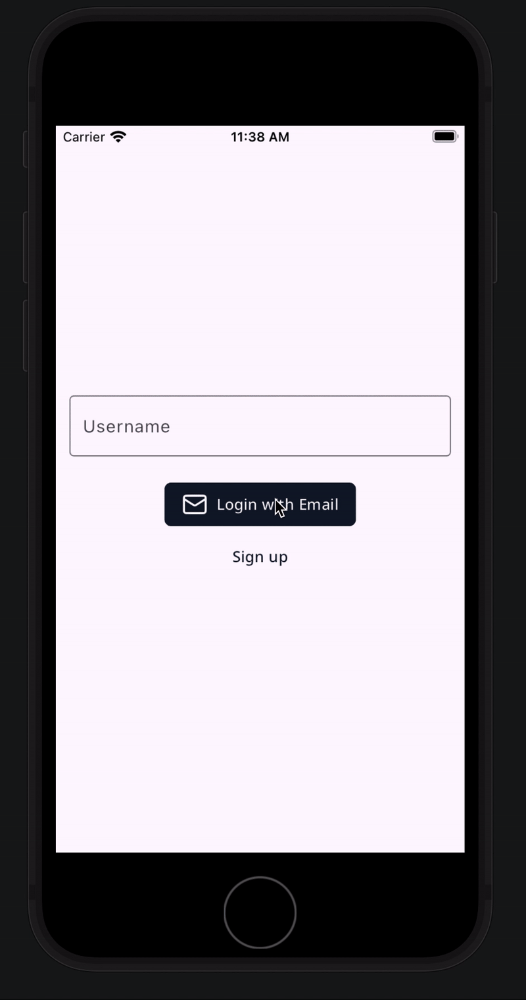

# Email Sanity

A Dart package for email validation that goes beyond syntax checks. It builds on [email_validator](https://pub.dev/packages/email_validator) and rejects common typos against known consumer email providers.

When the host’s first label matches a known provider alias (for example `gmail`, `yahoo`, `hotmail`), the full host must be one of that provider’s allowed domains (for example `gmail.com`). Unknown hosts that pass syntax validation are accepted.

**Providers checked:**

1. Google
2. Yahoo
3. Microsoft
4. Apple
5. Yandex
6. Fastmail



## Installation

Add this to your package’s `pubspec.yaml`:

```yaml
dependencies:
  email_sanity: ^0.2.0
```

Then fetch packages:

```bash
dart pub get
```

Import:

```dart
import 'package:email_sanity/email_sanity.dart';
```

## Usage

### Basic validation

```dart
void main() {
  final email = 'email@gmail.com';
  assert(EmailSanity.validate(email));
}
```

### Validation with details

```dart
void main() {
  final result = EmailSanity.validateWithDetails('email@gmail.com');
  print('Is valid: ${result.isValid}');
  print('Error: ${result.error}');
  print('Message: ${result.errorMessage}');
}
```

### Options

```dart
EmailSanity.validate(
  email,
  allowTopLevelDomains: false,
  allowInternational: true,
);
```

## Behavior notes

- Leading and trailing whitespace is trimmed before validation.
- Host comparison is case-insensitive (`User@Gmail.COM` is accepted).
- Lookalike hosts such as `gmail.com.attacker.com` or `me.company.com` are rejected when the first label is a known provider alias.
- Misspellings of the provider name itself (for example `gmial.com`) are not detected; only alias-matched hosts are checked against the allowlist.
